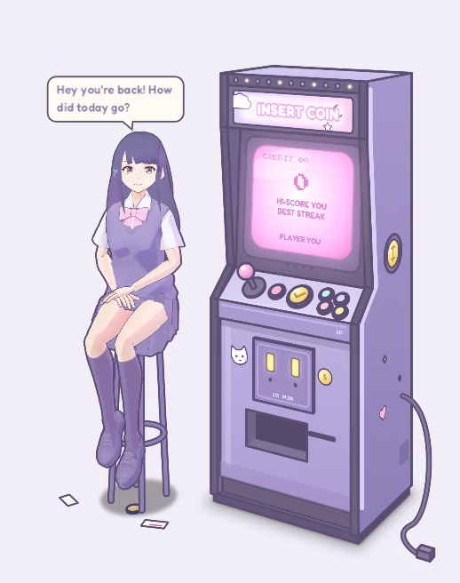

# Beside the Cabinet

*A companion who keeps you company beside a little arcade cabinet on your desktop.*

A cosy arcade cabinet sits in a corner of your screen, and a companion sits on a stool beside it. They talk with you,
typed or aloud, and remember your days: what you're working towards, your plans, how things went. They keep your agenda
and reminders, ask how something went afterwards, suggest a break when you've been sitting too long, and can text you on
Telegram while you're out. The cabinet keeps a gentle balance of work and play: focus sessions and the things you get
done earn play time, and it nudges, never blocks.

It's early, and for Windows. Two characters come with it, Shino and Fumiriya, each with a voice of their own; you can
bring your own.

## What it needs

- Windows 10 or 11, 64-bit.
- A mind for your companion: your own key for OpenAI, Anthropic, OpenRouter, DeepSeek or Qwen (each reply costs a
  little), or a model running on your own PC (Ollama, LM Studio), which is free.
- For a voice, an NVIDIA graphics card: voices run on GPT-SoVITS, which the app can download and install for you
  (8 GB). Without one, your companion talks in a speech bubble.

## Getting it running

1. Download the latest preview from [Releases](https://github.com/BobZheng00/Beside-The-Cabinet/releases), unzip it
   anywhere and run `BesideTheCabinet.exe`. The app isn't signed yet, so Windows may say it protected your PC: More
   info → Run anyway. Previews are early builds; you can also [build it from source](src/README.md).
2. The first run asks your name, who keeps you company and which mind to use.
3. Tray → **Getting started…** goes through the rest whenever you like: the voice, talking aloud, your phone, a calendar.

## What goes where

- **Your conversations** go only to the AI provider you chose, with your key. There is no server of ours in between,
  and no account.
- **Hearing you, the voice and memory search** run on your PC. Nothing is recorded: what you say aloud becomes words on
  your PC, and only the words are sent.
- **Your keys** are encrypted on your PC with Windows' own protection, never kept in plain text.
- **Only if you turn them on:** texts through Telegram (not end-to-end encrypted) or a webhook you set up, web searches
  through your provider or your own SearXNG, and your calendar's address.

## Characters and voices

Shino and Fumiriya are pixiv's CC0 VRoid sample models, with personas and voices of our own (the voices made with
Kokoro-82M). Add your own as a VRM model, a character card (SillyTavern style) or a voice: drop it on the cabinet
([how](src/InsertCoin.Game/characters/README.md)).
Voices shared online are often cut from games and anime: fine for yourself, never to share on.

## Learn more

- [Everything it does](docs/README.md): a guide to every feature and setting.
- [Characters](src/InsertCoin.Game/characters/README.md): adding your own models, character cards and voices.
- [Building from source](src/README.md): what you need, building, running, and how the code is laid out.
- [Dev keys and test runs](tools/dev/README.md): for working on the app.
- [How the app is put together](src/InsertCoin.Game/README.md): the companion's figure, chat, voice and ears, and the
  cabinet's skins.
- [Contributing](CONTRIBUTING.md); the design notes, research and publishing plans are in
  [docs](docs/README.md#more-in-this-folder).

## Licence

Beside the Cabinet is **source-available** under the [PolyForm Noncommercial License 1.0.0](LICENSE.md): you may use,
change and share it for free, for any noncommercial purpose; selling it, or using it commercially, isn't allowed. The
name, the cabinet's artwork and sounds, and the built-in characters' personas and voices aren't covered by that licence
([NOTICE.md](NOTICE.md)). Contributions are welcome under a short contributor agreement
([CONTRIBUTING.md](CONTRIBUTING.md)).
